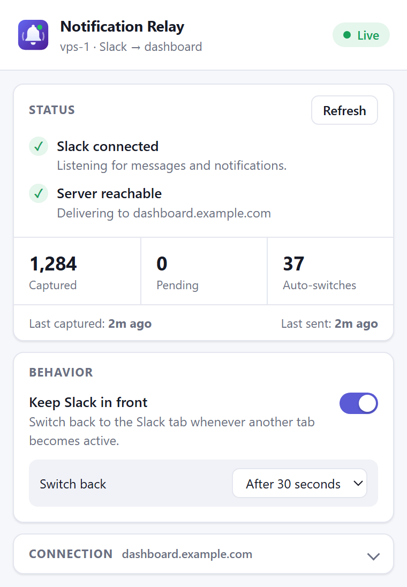
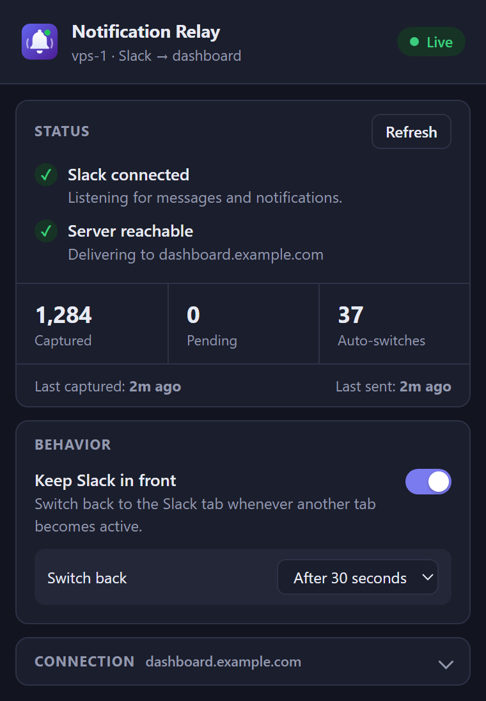

# Notification Relay

A Chrome (Manifest V3) extension that captures Slack messages and notifications in the browser and relays them to your own dashboard server.

<p align="center">
  
  &nbsp;&nbsp;
  
</p>

## Features

- **Two capture sources**
  - Wraps the page's `Notification` and `ServiceWorkerRegistration.showNotification` APIs to catch every browser notification Slack shows.
  - Watches the open Slack channel or thread and picks up new messages with their full text, sender, channel and attached file names.
- **Merging and de-duplication.** A message can arrive both as a short notification preview and as full page text. Notifications are held for 3 seconds so the full-text version replaces them. Identical items within 5 seconds are dropped.
- **Reliable delivery.** Items go into a persistent queue (up to 500) and are sent in batches of 50. Failed sends are retried every minute.
- **Tab health checks.** The extension keeps the Slack tab from being discarded, reloads it if Chrome discards it anyway, and re-injects the content scripts if they stop responding.
- **Keep Slack in front** (optional). Switches back to the Slack tab whenever another tab becomes active, either immediately or after a delay from 5 seconds to 15 minutes.
- **Status popup.** Shows a live health checklist, counts of captured, pending and auto-switched items, last capture and send times, and a **Send test** button.

## Installation

1. Clone or download this repository.
2. Open `chrome://extensions` and turn on **Developer mode**.
3. Click **Load unpacked** and select this folder.
4. Pin **Notification Relay** to the toolbar.
5. Open [app.slack.com](https://app.slack.com) in a tab and allow notifications for it.

## Configuration

Click the toolbar icon and expand **Connection**:

| Field      | Description                                                                 |
| ---------- | --------------------------------------------------------------------------- |
| VPS name   | Label for this machine. It is shown on the dashboard (default `unnamed-vps`). |
| Server URL | Base URL of your dashboard, e.g. `https://your-server.com`.                 |
| API key    | Must match `INGEST_API_KEY` on the server.                                  |

Click **Save**, then **Send test**. If Chrome has not granted access to the server's origin yet, the popup shows a **Grant access** banner.

## Server API

The extension sends a `POST` request to `<Server URL>/api/notifications/ingest`:

```http
POST /api/notifications/ingest
Content-Type: application/json
X-API-Key: <API key>
```

```json
{
  "notifications": [
    {
      "id": "slack-vps-1-1731400000.123456",
      "vps": "vps-1",
      "app": "slack",
      "title": "Jane Doe in general",
      "body": "Full message text…",
      "icon": "https://…/avatar.png",
      "tag": "1731400000.123456",
      "url": "https://app.slack.com/client/…",
      "pageTitle": "general (Channel) - Acme - Slack",
      "source": "dom",
      "capturedAt": 1731400000123
    }
  ]
}
```

`source` is one of `dom` (page watcher), `Notification`, `ServiceWorker` or `test`. Any `2xx` response marks the batch as delivered. Any other response, or a network error, keeps the batch queued for retry.

## Project structure

| File            | Role                                                                                               |
| --------------- | -------------------------------------------------------------------------------------------------- |
| `manifest.json` | Extension manifest (MV3).                                                                           |
| `background.js` | Service worker: queue, de-duplication and merging, delivery, tab health checks, Keep Slack in front. |
| `inject.js`     | Runs in the page's main world and wraps the Notification APIs.                                       |
| `bridge.js`     | Isolated content script that forwards captured notifications to the background and answers health pings. |
| `slack-dom.js`  | Watches the Slack DOM for newly rendered messages.                                                   |
| `options.html` / `options.js` | Toolbar popup and options page.                                                        |
| `icons/`        | Extension icons.                                                                                   |

## Troubleshooting

| Status in popup                          | What to do                                                       |
| ---------------------------------------- | ---------------------------------------------------------------- |
| No Slack tab open                        | Open `app.slack.com` in a tab.                                   |
| Slack connected, notifications blocked   | Allow notifications for `app.slack.com` in the site settings.    |
| Slack tab is frozen                      | Click the Slack tab once to wake it.                             |
| Slack tab not responding                 | Reload the Slack tab.                                            |
| No access to server                      | Click **Grant access**.                                          |
| Delivery failing                         | Check the server URL and API key. The error from the last attempt is shown. |

Debug logs are prefixed with `[relay]`. They appear in the service worker console (`chrome://extensions` → **Inspect views**) and in the Slack tab's DevTools console.

> The page watcher uses Slack's `data-qa` attributes, with class-name fallbacks. If Slack changes its markup, update the selectors in `slack-dom.js`.
